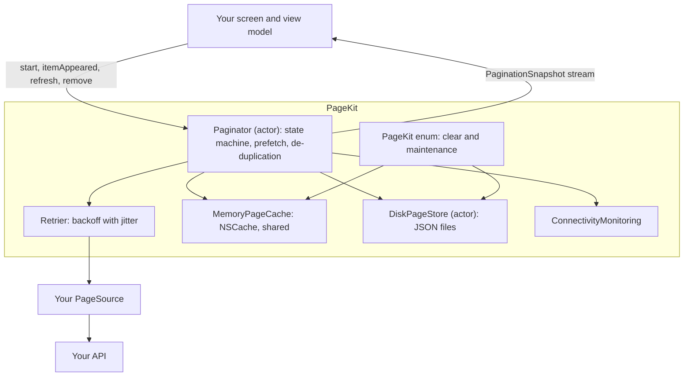

# PageKit

[](https://github.com/frankthamel/PageKit/actions/workflows/ci.yml)
[](https://frankthamel.github.io/PageKit/documentation/pagekit/)
[](https://swift.org)
[](#install)
[](#install)
[](LICENSE)

A zero-dependency Swift library for paginated lists. You write one small type that fetches a page. PageKit handles the rest: retries, in-memory and disk caching, offline reading, prefetching, duplicate removal, and one clear state for your UI to draw.

It has no UI code, so it works the same behind SwiftUI, UIKit, AppKit, a widget, a watch app or a command-line tool.

## Why PageKit

Every app with a feed ends up writing the same fragile code. PageKit gives you that code once, tested:

- **One engine for every API.** Page numbers, offsets, cursors, GraphQL connections and filtered lists all use the same `Page` shape.
- **One state at a time.** The list is always in exactly one `PaginationState`, and only `.loaded(hasMore: true)` can start the next page. Double loads, loads after the end and retry storms can't happen.
- **Fast to open.** Cached pages show at once, then the network quietly confirms them.
- **Works offline.** Pages are kept on disk, and the list picks up by itself when the connection returns.
- **Smooth scrolling.** No network, JSON or disk work touches the main thread, and each change arrives as one value.
- **Built for Swift 6.** `Paginator` is an actor, and every public type is `Sendable`.
- **No dependencies.** It imports only Foundation, Network, CryptoKit and os.

## Contents

- [30-second quick start](#30-second-quick-start)
- [Install](#install)
- [Concepts](#concepts)
- [Writing a source](#writing-a-source)
- [A reusable view model](#a-reusable-view-model)
- [SwiftUI screen](#swiftui-screen)
- [UIKit screen](#uikit-screen)
- [Recipes by use case](#recipes-by-use-case)
- [Cache policies](#cache-policies)
- [Offline](#offline)
- [Prefetching](#prefetching)
- [Editing items](#editing-items)
- [Clearing and logout](#clearing-and-logout)
- [Errors](#errors)
- [Configuration reference](#configuration-reference)
- [Paginator reference](#paginator-reference)
- [Concurrency and smooth scrolling](#concurrency-and-smooth-scrolling)
- [Testing your app](#testing-your-app)
- [Architecture](#architecture)
- [The name `PageKit`](#the-name-pagekit)
- [Demo app](#demo-app)
- [Contributing and licence](#contributing-and-licence)

## 30-second quick start

Add the package, describe your API, and show a list.

```swift
import Foundation
import PageKit
import SwiftUI

struct Product: Identifiable, Codable, Sendable {
    let id: Int
    let name: String
}

struct ProductsResponse: Decodable, Sendable {
    let products: [Product]
    let totalPages: Int
}

let productsSource = URLSessionPageSource<ProductsResponse, Product, IndexToken>(
    feedID: "products.home",
    firstToken: .first(size: 20),
    request: { token in
        URLRequest(url: URL(string: "https://api.example.com/products?page=\(token.page)&limit=\(token.size)")!)
    },
    map: { response, token in
        Page(items: response.products, nextToken: token.page < response.totalPages ? token.next : nil)
    }
)

struct ProductList: View {
    @State private var paginator = Paginator(source: productsSource)
    @State private var snapshot = PaginationSnapshot<Product>.initial

    var body: some View {
        List(snapshot.items) { product in
            Text(product.name)
                .onAppear { Task { await paginator.itemAppeared(id: product.id) } }
        }
        .task {
            await paginator.start()
            for await next in paginator.snapshots() { snapshot = next }
        }
    }
}
```

That list opens from cache, retries failures, saves pages to disk and loads the next page before the user reaches the end. For a real screen with footers, errors and pull to refresh, use the [view model](#a-reusable-view-model) and [screens](#swiftui-screen) below.

## Install

PageKit needs Swift 6.0 or later (Xcode 16 or later). It runs on iOS 15, macOS 12, tvOS 15 and watchOS 8.

**In Xcode:** choose **File > Add Package Dependencies**, then enter:

```
https://github.com/frankthamel/PageKit.git
```

**In `Package.swift`:**

```
dependencies: [
    .package(url: "https://github.com/frankthamel/PageKit.git", from: "0.1.0"),
],
targets: [
    .target(name: "YourApp", dependencies: ["PageKit"]),
]
```

## Concepts

An app works with four ideas.

**Tokens** name one page. PageKit never looks inside a token. It stores it, uses it as a cache key, saves it to disk and hands it back to you.

| Token | Use it for |
| --- | --- |
| `IndexToken` | Page numbers and offsets. The client works out the next page with `token.next`. `token.offset` gives the skip value. |
| `CursorToken` | Cursor APIs. The server hands back the next cursor. |
| Your own `PageToken` | Anything else the server needs, such as a filter or a GraphQL cursor. |

**`Page`** is one chunk of a list, plus the token for the next chunk. A `nil` next token means the list has ended. The same shape serves every kind of API, which is what lets one engine drive them all.

**`PageSource`** is the only protocol most apps implement. It has a stable `feedID`, a `firstToken`, and `loadPage(_:)`. The `feedID` is the cache key, so two different lists must never share one. Your items must be `Identifiable`, `Codable` and `Sendable`.

**`Paginator`** drives one list. Create one per feed, call `start()`, and render each `PaginationSnapshot` it sends. A snapshot holds everything a screen needs at one moment:

| Property | Meaning |
| --- | --- |
| `items` | What to show, in order, with no duplicate IDs. |
| `state` | Where the list is in its life cycle (see below). |
| `isStale` | Cached items are showing that the network hasn't confirmed yet. |
| `isOffline` | The device has no connection. Independent of `state`. |
| `lastError` | The latest error that didn't replace the items on screen. |

The states:

| `PaginationState` | Meaning | What to draw |
| --- | --- | --- |
| `.idle` | Nothing has been requested. | Nothing. |
| `.loadingFirstPage` | The first page is loading, with nothing to show. | A full-screen spinner. |
| `.loaded(hasMore:)` | Items are showing. `hasMore` is `false` at the end of the list. | The list, and an "all caught up" footer at the end. |
| `.loadingNextPage` | A later page is loading. | A spinner in the footer. |
| `.refreshing` | The list is reloading from page 1, with items still on screen. | The list. |
| `.empty` | The first page had no items, or the last item was removed. | An empty-state view. |
| `.failed(_, isFirstPage: true)` | A load failed with nothing to show. | A full-screen error with Retry. |
| `.failed(_, isFirstPage: false)` | The next page failed. Items stay on screen. | A retry button in the footer. |

## Writing a source

`URLSessionPageSource` covers simple JSON APIs, as in the quick start. It sends each request ignoring `URLCache`, with a 15-second timeout, and turns status codes into the right errors. For anything else, conform to `PageSource` around your own API client.

The examples below call an `APIClient`. That's your own type. It just needs to be `Sendable`.

**Page numbers.** The client works out the next token, and ends the list when the server says so.

```swift
struct ProductsSource: PageSource {
    let api: APIClient
    let feedID = "products.home"
    let firstToken = IndexToken.first(size: 20)

    func loadPage(_ token: IndexToken) async throws -> Page<Product, IndexToken> {
        let response = try await api.products(page: token.page, limit: token.size)
        let hasMore = token.page < response.totalPages
        return Page(items: response.products, nextToken: hasMore ? token.next : nil)
    }
}
```

**Offsets.** Use the same token and read `token.offset`. With no total from the server, a short page means the end.

```swift
struct AdminTableSource: PageSource {
    let api: APIClient
    let feedID = "admin.users"
    let firstToken = IndexToken.first(size: 40)

    func loadPage(_ token: IndexToken) async throws -> Page<Product, IndexToken> {
        let rows = try await api.rows(offset: token.offset, limit: token.size)
        return Page(items: rows, nextToken: rows.count == token.size ? token.next : nil)
    }
}
```

**Cursors.** The next cursor arrives with each page.

```swift
struct Post: Identifiable, Codable, Equatable, Sendable {
    let id: String
    var text: String
}

struct TimelineSource: PageSource {
    let api: APIClient
    let feedID = "timeline.home"
    let firstToken = CursorToken(value: nil, size: 20)

    func loadPage(_ token: CursorToken) async throws -> Page<Post, CursorToken> {
        let response = try await api.timeline(after: token.value, limit: token.size)
        return Page(
            items: response.posts,
            nextToken: response.nextCursor.map { CursorToken(value: $0, size: token.size) }
        )
    }
}
```

**A custom token.** Anything the server needs to continue the list goes in the token, so it is cached and restored with the page. All you need is `Hashable`, `Codable` and `Sendable`.

```swift
enum OrderStatus: String, Codable, Hashable, Sendable {
    case open, shipped
}

struct OrdersToken: PageToken {
    let after: String?          // pageInfo.endCursor from the previous page
    let status: OrderStatus
    let size: Int
}
```

If your token can work out the next one without asking the server, also implement `predictedNext`. PageKit then [reads ahead](#prefetching) in parallel, as it does for `IndexToken`.

**Failing.** Just throw. `URLError`, `DecodingError`, `PaginationError` and `PageKitHTTPError` are sorted automatically. If your client sees a raw HTTP status, throw `PageKitHTTPError(status:retryAfter:)` so that server errors are retried and client errors aren't. See [Errors](#errors).

## A reusable view model

One generic class serves every list screen in an app.

```swift
import Observation
import PageKit

@MainActor @Observable
final class FeedViewModel<Source: PageSource> {
    private(set) var snapshot = PaginationSnapshot<Source.Item>.initial   // ONE property: one render per page
    private let paginator: Paginator<Source>

    init(source: Source, configuration: PaginationConfiguration = .init()) {
        paginator = Paginator(source: source, configuration: configuration)
    }

    deinit {
        let paginator = paginator
        Task { await paginator.cancel() }       // stops loads and ends the stream
    }

    /// Call from the view's `.task`. SwiftUI cancels it when the view disappears.
    func run() async {
        await paginator.start()
        for await snapshot in paginator.snapshots() {
            self.snapshot = snapshot
        }
    }

    /// Runs in its own task, which `.refreshable` can't cancel. See the note below.
    func refresh() async {
        await Task { [paginator] in await paginator.refresh() }.value
    }

    func itemAppeared(_ item: Source.Item) {
        let id = item.id
        Task { await paginator.itemAppeared(id: id) }
    }

    func retry() { Task { await paginator.retry() } }
    func setAppActive(_ isActive: Bool) { Task { await paginator.setAppActive(isActive) } }

    /// Call these after the server has confirmed the change.
    func removeLocally(_ item: Source.Item) async { await paginator.remove(id: item.id) }
    func updateLocally(_ item: Source.Item) async { await paginator.update(item) }
}
```

> [!IMPORTANT]
> **Cancelling a caller aborts its load.** If the task awaiting `refresh()`, `loadNextPage()` or `retry()` is cancelled, the load stops and the list goes back to its earlier state. SwiftUI's `.refreshable` can cancel its task when the view re-renders, and a refresh is exactly what causes a re-render. So call `refresh()` from a task that outlives a re-render, as `refresh()` above does. Awaiting that task's `.value` keeps the spinner up until the load ends, and the cancellation never reaches it.

**On iOS 15 and 16,** make the same class an `ObservableObject` and hold it with `@StateObject`. Nothing else changes.

```swift
@MainActor
final class FeedViewModel<Source: PageSource>: ObservableObject {
    @Published private(set) var snapshot = PaginationSnapshot<Source.Item>.initial
    // The rest is the same.
}
```

## SwiftUI screen

`ProductCard` and `OfflineBanner` are your own views. The library only says which state the list is in. What each state looks like is up to you.

```swift
import PageKit
import SwiftUI

struct ProductGridView: View {
    @State private var model = FeedViewModel(source: ProductsSource(api: .live))
    @Environment(\.scenePhase) private var scenePhase

    var body: some View {
        ScrollView {
            LazyVGrid(columns: [GridItem(.adaptive(minimum: 160))]) {
                ForEach(model.snapshot.items) { product in          // keyed by product.id
                    ProductCard(product: product)
                        .onAppear { model.itemAppeared(product) }   // drives prefetching
                }
            }
            PageFooter(state: model.snapshot.state, retry: model.retry)
        }
        .overlay { FirstPageOverlay(state: model.snapshot.state, retry: model.retry) }
        .safeAreaInset(edge: .top) { if model.snapshot.isOffline { OfflineBanner() } }
        .task { await model.run() }
        .refreshable { await model.refresh() }
        .onChange(of: scenePhase) { _, phase in model.setAppActive(phase == .active) }
    }
}

/// The bottom of the list.
struct PageFooter: View {
    let state: PaginationState
    let retry: () -> Void

    var body: some View {
        switch state {
        case .loadingNextPage:
            ProgressView().frame(maxWidth: .infinity).padding()
        case .failed(_, isFirstPage: false):
            Button("Couldn't load more. Tap to retry.", action: retry).padding()
        case .loaded(hasMore: false):
            Text("You're all caught up").foregroundStyle(.secondary).padding()
        default:
            EmptyView()
        }
    }
}

/// The screen while there is nothing to list.
struct FirstPageOverlay: View {
    let state: PaginationState
    let retry: () -> Void

    var body: some View {
        switch state {
        case .loadingFirstPage:
            ProgressView()
        case .empty:
            Text("Nothing here yet").foregroundStyle(.secondary)
        case .failed(_, isFirstPage: true):
            VStack(spacing: 12) {
                Text("Couldn't load this list.")
                Button("Retry", action: retry)
            }
        default:
            EmptyView()
        }
    }
}
```

## UIKit screen

Put IDs in the diffable snapshot, keep the items in a dictionary, and reconfigure cells that changed. Create the controller with `TimelineViewController(collectionViewLayout: layout)`.

```swift
import PageKit
import UIKit

@MainActor
final class TimelineViewController: UICollectionViewController, UICollectionViewDataSourcePrefetching {
    private let paginator = Paginator(source: TimelineSource(api: .live))
    private var dataSource: UICollectionViewDiffableDataSource<Int, Post.ID>!
    private var postsByID: [Post.ID: Post] = [:]

    override func viewDidLoad() {
        super.viewDidLoad()
        collectionView.prefetchDataSource = self
        dataSource = makeDataSource()
        Task { [weak self, paginator] in
            await paginator.start()
            for await snapshot in paginator.snapshots() { self?.render(snapshot) }
        }
    }

    deinit {
        let paginator = paginator
        Task { await paginator.cancel() }       // ends the stream, so the loop above finishes
    }

    private func makeDataSource() -> UICollectionViewDiffableDataSource<Int, Post.ID> {
        let cell = UICollectionView.CellRegistration<UICollectionViewListCell, Post.ID> { [weak self] cell, _, id in
            var content = cell.defaultContentConfiguration()
            content.text = self?.postsByID[id]?.text
            cell.contentConfiguration = content
        }
        return UICollectionViewDiffableDataSource(collectionView: collectionView) { view, indexPath, id in
            view.dequeueConfiguredReusableCell(using: cell, for: indexPath, item: id)
        }
    }

    private func render(_ snapshot: PaginationSnapshot<Post>) {
        // Posts whose content changed are reconfigured, not replaced.
        let edited = snapshot.items.filter { new in postsByID[new.id].map { $0 != new } ?? false }.map(\.id)
        postsByID = Dictionary(uniqueKeysWithValues: snapshot.items.map { ($0.id, $0) })

        var diff = NSDiffableDataSourceSnapshot<Int, Post.ID>()
        diff.appendSections([0])
        diff.appendItems(snapshot.items.map(\.id))
        diff.reconfigureItems(edited)
        dataSource.apply(diff, animatingDifferences: false)
        updateFooter(for: snapshot.state)
    }

    private func updateFooter(for state: PaginationState) {
        // Show a spinner, a retry button or nothing, in a view you own.
    }

    // Two prefetch signals, both forwarded as plain indexes.
    override func collectionView(
        _ collectionView: UICollectionView, willDisplay cell: UICollectionViewCell, forItemAt indexPath: IndexPath
    ) {
        Task { await paginator.prefetch(upToIndex: indexPath.item) }
    }

    func collectionView(_ collectionView: UICollectionView, prefetchItemsAt indexPaths: [IndexPath]) {
        guard let furthest = indexPaths.map(\.item).max() else { return }
        Task { await paginator.prefetch(upToIndex: furthest) }
    }
}
```

## Recipes by use case

The same two app-side types cover every case. Only the source and the configuration change.

| Use case | Example | Token | Cache policy | Other settings |
| --- | --- | --- | --- | --- |
| Page-number API | Product catalogue | `IndexToken` | `.cacheThenNetwork` | Defaults |
| Offset API | Admin table, `?offset=40&limit=20` | `IndexToken` (use `token.offset`) | `.cacheThenNetwork` | Defaults |
| API returns total pages | Order history | `IndexToken` | `.cacheThenNetwork` | End when `page >= totalPages` |
| Cursor feed | Social timeline, notifications | `CursorToken` | `.cacheThenNetwork` | Defaults |
| Search results | Product search | `CursorToken` or `IndexToken` | `.networkFirst` | `feedID` includes the query; short `maxAge` |
| Offline-first reading | Saved articles, recipes | Either | `.cacheThenNetwork` | `storage = .durable`, `maxAge` 30 days |
| Live data | Prices, stock levels, bids | Either | `.networkOnly` | Defaults |
| Filtered or GraphQL lists | Orders by status, Relay connection | Custom `PageToken` | `.cacheThenNetwork` | Filter inside the token |

**Search.** Each query is its own feed, so results for "shoes" never mix with "boots", and going back to "shoes" is served from cache. The view model swaps paginators and debounces typing.

```swift
struct SearchSource: PageSource {
    let api: APIClient
    let query: String
    var feedID: String { "search." + query.lowercased() }
    let firstToken = CursorToken(value: nil, size: 20)

    func loadPage(_ token: CursorToken) async throws -> Page<Product, CursorToken> {
        let response = try await api.search(query, after: token.value, limit: token.size)
        return Page(
            items: response.products,
            nextToken: response.nextCursor.map { CursorToken(value: $0, size: token.size) }
        )
    }
}

@MainActor @Observable
final class SearchViewModel {
    private(set) var snapshot = PaginationSnapshot<Product>.initial
    private var paginator: Paginator<SearchSource>?
    private var searchTask: Task<Void, Never>?
    private let api: APIClient

    init(api: APIClient) {
        self.api = api
    }

    func queryChanged(_ text: String) {
        searchTask?.cancel()
        searchTask = Task {
            try? await Task.sleep(nanoseconds: 300_000_000)      // debounce typing
            guard !Task.isCancelled else { return }
            await paginator?.cancel()                            // stop the previous query
            var config = PaginationConfiguration()
            config.cachePolicy = .networkFirst
            config.maxAge = 60 * 60                              // search results go stale fast
            let next = Paginator(source: SearchSource(api: api, query: text), configuration: config)
            paginator = next
            await next.start()
            for await snapshot in next.snapshots() { self.snapshot = snapshot }
        }
    }
}
```

**Offline-first reading list.** The screen reads `snapshot.isOffline` to show a banner, and `snapshot.isStale` to show a quiet "Updating…" label.

```swift
struct SavedArticlesSource: PageSource {
    let api: APIClient
    let feedID = "articles.saved"
    let firstToken = IndexToken.first(size: 20)

    func loadPage(_ token: IndexToken) async throws -> Page<Product, IndexToken> {
        let rows = try await api.rows(offset: token.offset, limit: token.size)
        return Page(items: rows, nextToken: rows.count == token.size ? token.next : nil)
    }
}

@MainActor
func makeReadingList() -> FeedViewModel<SavedArticlesSource> {
    var config = PaginationConfiguration()
    config.storage = .durable                 // Application Support, not Caches
    config.maxAge = 30 * 24 * 3600            // keep a month of articles
    return FeedViewModel(source: SavedArticlesSource(api: .live), configuration: config)
}
```

**Live data.** Set `config.cachePolicy = .networkOnly`. Prices are never shown from cache, and nothing is fetched ahead that would be out of date by the time it is seen.

**Several lists on one screen.** Create one paginator per tab, with distinct `feedID`s. Each has its own state, cache entries and requests, and switching tabs is instant because the inactive tab keeps its snapshot.

## Cache policies

Set `cachePolicy` on `PaginationConfiguration`. The default suits most feeds.

| Policy | Opening the feed | Next page | Reads ahead | Writes caches | Use it for |
| --- | --- | --- | --- | --- | --- |
| `.cacheThenNetwork` (default) | Shows the saved list at once, marked stale, then checks page 1 against the network. | Cache, then network. | Yes | Yes | Almost everything. |
| `.networkFirst` | Network. If that fails, shows the saved list with `lastError` set. | Network, then cache on failure. | No | Yes | Search, or data that should be fresh when it can be. |
| `.networkOnly` | Network. | Network. | No | No | Prices, stock levels, anything that must be live. |
| `.cacheOnly` | Shows the saved list, or `.empty` if there is none. | Cache. A miss ends the list. | No | No network, so nothing new | An explicit offline mode. |

Under `.cacheThenNetwork`, if page 1 from the network still leads into the same pages, the items update in place and the list keeps its position. If it doesn't, the new page 1 replaces the list and the old cached pages go. Under `.cacheOnly`, `refresh()` does nothing, as that policy never uses the network.

## Offline

A feed works offline with no extra code. Pages are kept on disk as you load them, and the next launch opens from them.

- **`isOffline` is a label.** PageKit never holds a request back because of it, since a device's network status can be wrong. Read it to show a banner.
- **Reconnecting is automatic.** When the connection returns, PageKit quietly refreshes a one-page list and retries whatever failed. Longer lists stay as they are, because a refresh could shrink them under the user's thumb, and `isStale` stays `true` until the next `refresh()`.
- **Tell it when the app is in the background** with `setAppActive(_:)` from `scenePhase`, as the [SwiftUI screen](#swiftui-screen) does. A reconnect that happens in the background is picked up on return.

**Where pages live.** `configuration.storage` picks the folder.

| `DiskStorage` | Folder | Behaviour |
| --- | --- | --- |
| `.caches` (default) | Caches | iOS may clear it when space runs low. Oldest feeds are evicted once the folder passes its size limit. |
| `.durable` | Application Support | Excluded from backup. Exempt from size eviction, so it can grow past `diskSizeLimit`. Feeds still expire at `maxAge`. |

Use `.durable` if your app promises offline reading, and set a long enough `maxAge`. Since nothing evicts those feeds by size, give users a way to clear what they no longer need.

**When your model changes,** bump `schemaVersion`. Files saved with another version are discarded rather than failing to decode. A corrupt file is treated as a cache miss: it is deleted, and the feed loads from the network.

**Connectivity.** `ConnectivityStatus` reports `isOnline`, `isExpensive` and `isConstrained`. The default monitor, `NetworkPathMonitor`, watches the real network. To replace it, pass your own `ConnectivityMonitoring` to `Paginator(source:configuration:connectivity:)`.

## Prefetching

There are two levels, and together they mean the user rarely sees a spinner.

**The distance trigger** loads the next page when the user is within `prefetchDistance` items of the end (5 by default). Call `itemAppeared(id:)` from each cell's `onAppear`, or `prefetch(upToIndex:)` from UIKit. Both are cheap, so call them for every cell. Nothing happens while the list is loading, failed or finished, or while the app is in the background.

**Read-ahead** fetches `lookaheadPages` pages beyond the list (1 by default) and parks them in the cache, so that the next load needs no network. Set it to 0 to turn this off.

- It only runs under `.cacheThenNetwork`. `.networkFirst`, `.cacheOnly` and `.networkOnly` don't read ahead. A `.networkFirst` feed would fetch the same pages again anyway, and a `.cacheOnly` feed has no network to use.
- It stays off on cellular, hotspots and Low Data Mode, to protect the user's data plan. Set `allowsReadAheadOnExpensiveNetwork` to `true` to allow it.
- It stops in the background, and needs a known online status.
- Tokens that can predict their successor (`predictedNext`), such as `IndexToken`, fetch up to two pages in parallel. Cursor feeds fetch one at a time, since each cursor arrives with the page before it.

**A page with no items but a next token.** A server can send this, and PageKit won't spin on it. The state is `.loaded(hasMore: true)` and nothing loads by itself, because nothing on screen leads to the next page. To move past it, call `loadNextPage()`, for example from a "Load more" button.

## Editing items

`remove(id:)` and `update(_:)` change the list, the memory cache and the disk cache together, and return once the change is on disk. A relaunch won't bring a deleted post back.

> [!IMPORTANT]
> **Tell your server first.** Call these after the server has confirmed the change. PageKit removes the item from pages requested before the edit, but it believes any page requested afterwards. If the server still has the item, the next load puts it back.

```swift
struct DeleteProduct {
    let api: APIClient
    let model: FeedViewModel<ProductsSource>

    @MainActor
    func callAsFunction(_ product: Product) async throws {
        try await api.deleteProduct(id: product.id)     // the server first
        await model.removeLocally(product)              // then the list and caches
    }
}
```

An unknown ID is ignored. Removing the last item moves the state to `.empty`, or loads the next page if there is one.

## Clearing and logout

The `PageKit` enum holds the actions that aren't tied to one paginator.

| Call | What it does |
| --- | --- |
| `await PageKit.clear(feedID:)` | Deletes one feed from memory and both disk locations. |
| `await PageKit.clearAll()` | Deletes every feed from memory and both disk locations. |
| `PageKit.clearMemoryCache()` | Empties the memory cache. Pages on disk stay. Not `async`. |
| `await PageKit.performMaintenance()` | Deletes expired feeds, then trims the caches folder to size. |

Maintenance runs by itself a few seconds after the first feed opens, once per launch. You can also call it from a background task such as `BGAppRefreshTask`. It works on disk only: pages in memory aren't purged by age, as they go when the system or the cache's limits need the room.

**On logout,** finish the wipe before you move on:

```swift
struct Session {
    let api: APIClient
    let showLogin: @MainActor () -> Void

    @MainActor
    func logOut() async {
        await api.revokeTokens()
        await PageKit.clearAll()      // memory and disk, every feed
        showLogin()                   // only after the wipe finishes
    }
}
```

A page that was requested before a clear is never cached after it, so a slow response can't undo a logout. Clearing doesn't touch a paginator that is still alive, though, and its items stay on screen. Dismiss those screens, so that their view models cancel their paginators, as part of `showLogin`.

## Errors

Every failure is sorted into a `PaginationError`, so the engine knows whether to retry and your UI knows what to say.

| `PaginationError` | Comes from | Retried automatically |
| --- | --- | --- |
| `.offline` | `URLError` for no connection or a lost one | No, the list resumes on reconnect |
| `.timedOut` | `URLError.timedOut` | Yes |
| `.rateLimited(retryAfter:)` | HTTP 429 | Yes, waiting as long as the server asked |
| `.server(status:)` | HTTP 5xx | Yes |
| `.client(status:)` | Other HTTP 4xx | No |
| `.decoding(underlying:)` | `DecodingError` | No |
| `.other(underlying:)` | Anything else | No |

Retries use backoff with jitter, as set by `retry`. Cancellation isn't an error: a cancelled load just returns the list to its earlier state.

Failures reach the UI in one of two ways:

- **In `state`,** when the failure is what the list is waiting on: `.failed(error, isFirstPage: true)` with nothing on screen, or `.failed(error, isFirstPage: false)` for a next page. Call `retry()`, which repeats the failed load.
- **In `lastError`,** when the items on screen are still good: a failed `refresh()`, a failed check of cached items, or a `.networkFirst` feed showing its cache. The state stays `.loaded`, the list stays usable, and the next success clears it. Show something quiet:

```swift
import PageKit
import SwiftUI

struct RefreshErrorLabel: View {
    let error: PaginationError?

    var body: some View {
        switch error {
        case .none:
            EmptyView()
        case .offline:
            Text("You're offline. Showing saved items.").font(.footnote)
        case .some:
            Text("Couldn't update. Showing saved items.").font(.footnote)
        }
    }
}
```

## Configuration reference

Every value has a safe default, so most apps change nothing.

```swift
func makeConfiguration() -> PaginationConfiguration {
    var config = PaginationConfiguration()
    config.prefetchDistance = 10
    config.retry = RetryPolicy(maxAttempts: 5, baseDelay: 1, maxDelay: 30)
    return config
}
```

| `PaginationConfiguration` | Default | Meaning |
| --- | --- | --- |
| `cachePolicy` | `.cacheThenNetwork` | How the caches are used. |
| `prefetchDistance` | `5` | Load the next page when this many items remain. |
| `lookaheadPages` | `1` | Pages to fetch ahead and park in the cache. `0` turns this off. Only under `.cacheThenNetwork`. |
| `memoryCostLimit` | 20 MB | The memory cache budget, in bytes. The memory cache is shared, so the largest value any paginator asks for applies. |
| `diskSizeLimit` | 50 MB | The caches folder budget, in bytes. The largest value saved in the folder applies. `.durable` feeds are exempt. |
| `maxAge` | 7 days | Disk entries older than this, in seconds, are deleted. |
| `retry` | `RetryPolicy.default` | How failed loads are retried. |
| `schemaVersion` | `1` | Bump it when the item's shape changes. |
| `storage` | `.caches` | Where pages are kept on disk. |
| `allowsReadAheadOnExpensiveNetwork` | `false` | Whether to read ahead on cellular, hotspots and Low Data Mode. |

| `RetryPolicy` | Default | Meaning |
| --- | --- | --- |
| `maxAttempts` | `3` | Tries in total, including the first. |
| `baseDelay` | 0.5 s | The wait before the first retry. It doubles each time. |
| `maxDelay` | 8 s | The longest wait between tries. |

These values are fixed:

| Behaviour | Value |
| --- | --- |
| Retry jitter | Each wait is multiplied by a random 0.5 to 1.0 |
| Memory cache entry limit | 200 pages |
| Disk eviction target | Down to 80% of the limit, oldest feeds first |
| Parallel read-ahead | 2 requests |
| `URLSessionPageSource` request timeout | 15 s |
| Automatic maintenance | About 5 s after the first feed opens, once per launch |

## Paginator reference

| Call | What it does |
| --- | --- |
| `Paginator(source:configuration:connectivity:)` | Creates a paginator. Nothing loads until `start()`. |
| `snapshots()` | A new stream on every call, with no `await` needed. It starts with the current snapshot, then delivers every change. Any number of observers may listen. |
| `start()` | Begins loading and returns at once. Calling it again does nothing. |
| `loadNextPage()` | Loads the next page, if the state is `.loaded(hasMore: true)`. |
| `refresh()` | Reloads from page 1. On success the new page replaces the list. On failure every item stays. |
| `retry()` | Repeats the load that last failed. |
| `itemAppeared(id:)` | Tells the paginator a cell came on screen. |
| `prefetch(upToIndex:)` | The same, by index, for UIKit. |
| `setAppActive(_:)` | Tells the paginator whether the app is in the foreground. |
| `remove(id:)`, `update(_:)` | Edit one item everywhere. Tell your server first. |
| `cancel()` | Stops all work and finishes every stream. This is final: make a new paginator to show the feed again. |

## Concurrency and smooth scrolling

`Paginator` is an actor, and everything it hands out is `Sendable`, so it's safe to call from any task. It builds with no warnings under strict concurrency.

- **Two callers for one page share one request.** A second caller joins the first caller's request.
- **Stale results are dropped.** After every `await` the paginator re-checks that its work still counts, so a late response can't overwrite a newer list.
- **Cancelling a caller aborts its load,** as [described above](#a-reusable-view-model). `start()` isn't affected, as it runs in its own task, and neither is a cancelled `.task` loop over `snapshots()`.

A scroll stays smooth when the main thread finishes each frame in under 8 ms at 120 Hz, or 16 ms at 60 Hz. PageKit has no UI, so smoothness is a shared contract.

**What the library guarantees:**

1. **No I/O or decoding on the main thread.** Network, JSON and disk work all run off it.
2. **One snapshot per change.** Items, state and flags change together in one value, so you can update your UI once per page.
3. **Stable, unique identity.** Every item in a snapshot has a unique `id`, so lists diff cheaply and reuse cells.
4. **Constant-time prefetch hooks.** `itemAppeared(id:)` is a dictionary lookup.
5. **The next page is usually already there,** thanks to prefetch and read-ahead.

**What your UI must do:**

| Do | Don't | Why |
| --- | --- | --- |
| Store the whole snapshot in one `@Published` or `@Observable` property | Copy `items` and `state` into separate properties | Two properties cause two renders per page. |
| Use `List`, `LazyVStack` or `UICollectionView` | Use a plain `VStack` in a `ScrollView` | A plain stack builds every row up front. |
| Key rows by `item.id` | Write `.id(UUID())` or key by array index | A new identity on each render throws the cell away and rebuilds it. |
| In UIKit, put IDs in the diffable snapshot and call `reconfigureItems` for edits | Put whole items in the diffable snapshot | Diffing small IDs is cheaper, and reconfiguring updates the existing cell. |
| Apply appended pages with `animatingDifferences: false` | Animate 20 inserted rows at the bottom | The animation costs frames and the user can't see it. |
| Load images asynchronously with your own image pipeline | Decode images in the row's `body` or `cellForItemAt` | Image decoding is the most common cause of scroll hitches. |
| Keep the loading footer as its own row driven by `state` | Insert a fake "loading" item into the item array | A fake item breaks identity and diffing. |

## Testing your app

`Paginator` takes any `PageSource`, so your tests need no network and no UI. Write a fake source and a fake connectivity monitor, and assert on what arrives on `snapshots()`.

Use `.networkOnly` in tests. Cached pages go to the app's real caches folders, and this keeps each test off them and independent of the last.

```swift
import PageKit
import Testing

struct Row: Identifiable, Codable, Sendable {
    let id: Int
}

struct FakeSource: PageSource {
    let feedID = "test.rows"
    let firstToken = IndexToken.first(size: 2)

    func loadPage(_ token: IndexToken) async throws -> Page<Row, IndexToken> {
        let hasMore = token.page < 2
        let first = (token.page - 1) * token.size
        return Page(items: (first..<first + token.size).map(Row.init), nextToken: hasMore ? token.next : nil)
    }
}

struct AlwaysOnline: ConnectivityMonitoring {
    func updates() -> AsyncStream<ConnectivityStatus> {
        AsyncStream { $0.yield(.online) }
    }
}

@Test func loadsToTheEndOfTheList() async {
    var config = PaginationConfiguration()
    config.cachePolicy = .networkOnly
    let paginator = Paginator(source: FakeSource(), configuration: config, connectivity: AlwaysOnline())

    await paginator.start()
    _ = await paginator.snapshots().first { $0.state == .loaded(hasMore: true) }
    await paginator.loadNextPage()

    let last = await paginator.snapshots().first { $0.state == .loaded(hasMore: false) }
    #expect(last?.items.count == 4)
    await paginator.cancel()
}
```

To test a view model, inject the same fake source, call `run()` in a task, and assert on `snapshot.state` and `snapshot.items`. To exercise failures, throw from the fake source. For offline behaviour, make a fake monitor that yields `ConnectivityStatus(isOnline: false)`.

## Architecture



Loads go memory, then disk, then network, as the cache policy allows. Every load runs through one state machine, and the list only ever changes by one published snapshot.

PageKit includes a privacy manifest. It reads file dates for eviction, collects no data and does no tracking. It follows [semantic versioning](https://semver.org), and CI checks for accidental API breaks.

## The name `PageKit`

`PageKit` is both the module and a public enum inside it. In your code, `PageKit.clearAll()` refers to the enum, which is what you want. This has two side effects:

- You can't write `PageKit.Paginator` to qualify a type with its module, because `PageKit` resolves to the enum. If another module in your app also has a `Paginator`, import it by name: `import class PageKit.Paginator`.
- A module and a type with one name is legal, but it doesn't work with library evolution. Don't build PageKit with `BUILD_LIBRARY_FOR_DISTRIBUTION`. Add it as a source package.

## Demo app

[PageKitDemo](https://github.com/frankthamel/PageKitDemo) is a full news reader built on PageKit. One feed uses `IndexToken` and another uses `CursorToken`, driven by the same view model and views, and a panel simulates slow, failing and offline networks.

## Contributing and licence

- API documentation: [frankthamel.github.io/PageKit](https://frankthamel.github.io/PageKit/documentation/pagekit/), with articles and a tutorial.
- Changes: [CHANGELOG.md](CHANGELOG.md).
- Contributions are welcome. See [CONTRIBUTING.md](CONTRIBUTING.md) and our [Code of Conduct](CODE_OF_CONDUCT.md).

PageKit is available under the MIT licence. See [LICENSE](LICENSE).
